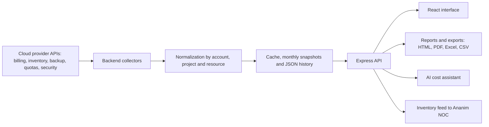
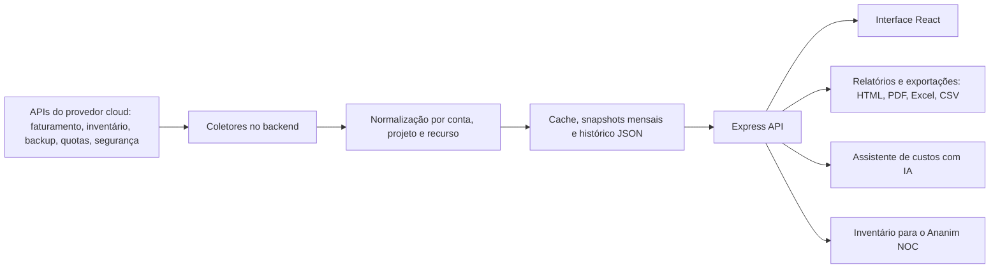

# Architecture — AnanimCloudReport

[English](#english) · [Português](#português)

## English

Logical diagram — no addresses, credentials or client topology.

### Provider integration

Providers are plugged in through connectors that translate billing and inventory into a common model (account → project → resource → period). Connectors must validate currency, discounts, taxes, granularity and refresh time before financial comparisons are allowed. Huawei Cloud is the connector in production.

### Engineering decisions

- **Collection in the backend** — authentication and provider credentials never reach the browser or this public portfolio.
- **Cached results with visible freshness** — expensive API calls are not repeated per click, and the UI shows when data was last refreshed.
- **Automatic monthly snapshots** — the month is opened and closed by the server, so month-over-month history does not depend on someone remembering to export.
- **Explicit financial criteria** — raw billing, attributed cost and commercial adjustments have explicit meanings; client prices and percentages are configuration.
- **White-label by configuration** — branding, letterhead, accounts, policies and thresholds are configuration; the same build can serve any company or run as SaaS.
- **File-based persistence** — simple to operate; requires care with concurrent writes, backups and growth (see roadmap).

### Validation

Changes are validated at separate levels: syntax/build, isolated tests, deployment and real behavior with real data.

### Limits

- Estimates and opportunities are not realized savings.
- Inventory, billing and operational state may be refreshed at different times.
- Reports do not replace invoice validation, license contracts or restore tests.

## Português

Diagrama lógico — sem endereços, credenciais ou topologia de clientes.

### Integração com provedores

Os provedores entram por conectores que traduzem faturamento e inventário para um modelo comum (conta → projeto → recurso → período). Os conectores precisam validar moeda, descontos, impostos, granularidade e momento de atualização antes de permitir comparações financeiras. Huawei Cloud é o conector em produção.

### Decisões de engenharia

- **Coleta no backend** — autenticação e credenciais dos provedores nunca chegam ao navegador nem a este portfólio público.
- **Cache com atualização visível** — chamadas caras não se repetem a cada clique, e a interface mostra quando o dado foi atualizado.
- **Snapshots mensais automáticos** — o servidor abre e fecha o mês, então o histórico mês a mês não depende de alguém lembrar de exportar.
- **Critério financeiro explícito** — faturamento bruto, custo atribuído e ajustes comerciais têm significado explícito; preços e percentuais de clientes são configuração.
- **White-label por configuração** — marca, papel timbrado, contas, políticas e limiares são configuração; o mesmo build atende qualquer empresa ou roda como SaaS.
- **Persistência em arquivos** — simples de operar; exige cuidado com escrita concorrente, backup e crescimento (ver roadmap).

### Validação

Mudanças são validadas em níveis separados: sintaxe/build, testes isolados, publicação e comportamento real com dados reais.

### Limites

- Estimativas e oportunidades não são economia realizada.
- Inventário, cobrança e estado operacional podem ser atualizados em momentos diferentes.
- Relatórios não substituem validação da fatura, contrato de licenciamento ou teste de restauração.
