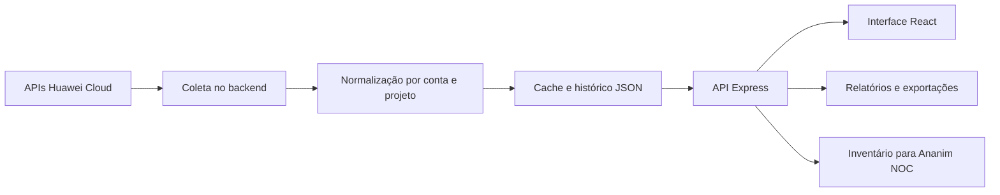

# Arquitetura — AnanimCloudReport

Diagrama lógico, sem endereços, credenciais ou topologia de clientes.

## Decisões de engenharia

### Coleta no backend

Concentra autenticação e integração; credenciais não pertencem à apresentação pública.

### Cache de resultados

Evita repetir chamadas caras em cada navegação e permite acompanhar a atualização. A interface precisa distinguir dado recente de coleta atrasada.

### Critério financeiro configurável

Valores brutos e ajustes comerciais precisam ter significado explícito. Percentuais e valores de clientes não são divulgados neste portfólio.

### Persistência em arquivos

Mantém a operação simples, mas exige atenção a escrita concorrente, consistência, backup e evolução do volume.

## Validação e operação

A validação de mudanças deve distinguir sintaxe/build, testes isolados, publicação e comportamento real. Um processo iniciado, uma resposta HTTP ou um botão habilitado não comprovam, isoladamente, o resultado esperado. Os detalhes operacionais, credenciais e registros de clientes ficam fora deste repositório.

## Fronteiras de responsabilidade

- O recorte implementado é Huawei Cloud; não é anunciado como plataforma multicloud pronta.
- Estimativas e oportunidades não equivalem a economia realizada ou garantida.
- Inventário, cobrança e estado operacional podem ter instantes de atualização diferentes.
- Relatórios não substituem validação da fatura, contrato de licenciamento ou teste de restauração.
