# Cloud Report

**Cloud FinOps & Governance** — from the invoice to the resource, from the resource to the decision.

[English](README.md) · [Português](README.pt-BR.md)

A FinOps, cost and governance platform for cloud environments. It joins billing, inventory, backups, quotas, licensing and operational context to answer *how much each project consumes, which resources drive that cost, what is idle and where to act*.

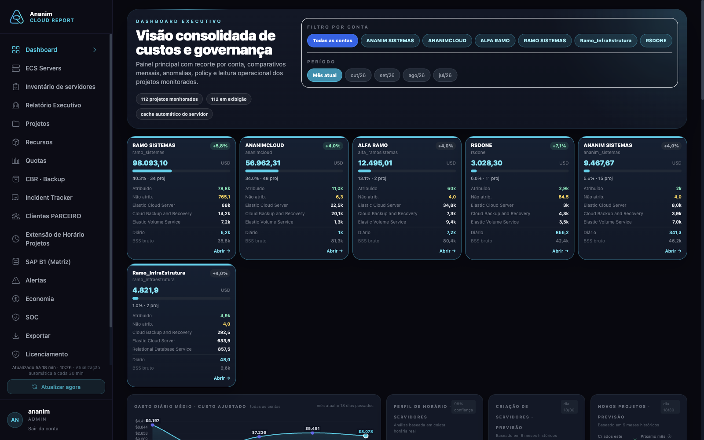

> **Portfolio of Gustavo Souza.** **About the screenshots:** they are real captures of the production interface (November 2026). Client names, hostnames, IP addresses, users, e-mails and domains were replaced automatically at capture time by fictitious ones (e.g. `CLIENTE ALFA`, `app2.exemplo.com`, `usuario.1`, `10.20.x.x`); cloud account names and the operator's brand are blurred; financial values are scrambled. Layout, features and workflows are exactly what runs in production.

## The problem

An invoice shows amounts but does not explain the environment. Data is spread across accounts, projects, servers, disks, backups and quotas, which makes manual analysis slow and inconsistent. Cloud Report puts it in one view with account, project and period filters, and turns it into alerts, savings and reports.

## At a glance

| Area | What it delivers |
|---|---|
| **Cost visibility** | Cost per account and project, month-over-month, attributed vs unattributed, top services. |
| **Inventory** | Every server with OS, vCPU, memory, disk, environment and status; licensing / end-of-life. |
| **Waste & savings** | Idle IPs, volumes, VPNs, buckets, stopped servers, oversized backup vaults — with $ per month. |
| **Governance** | Flavor and bandwidth policy, cost anomalies, quota usage, duplicated projects. |
| **Backups** | Vault capacity, deleted resources still billed, manual backups, out-of-policy resources. |
| **Business** | Contract price vs real cost, partner billing, extended-hours charging, incident tracker. |
| **AI** | Cost assistant that answers questions over all accounts, with an admin question log. |
| **Reports** | Automatic monthly snapshots, branded HTML/PDF, Excel and CSV everywhere, e-mail. |

<table><tr><td width="33%"> Executive cost dashboard</td><td width="33%">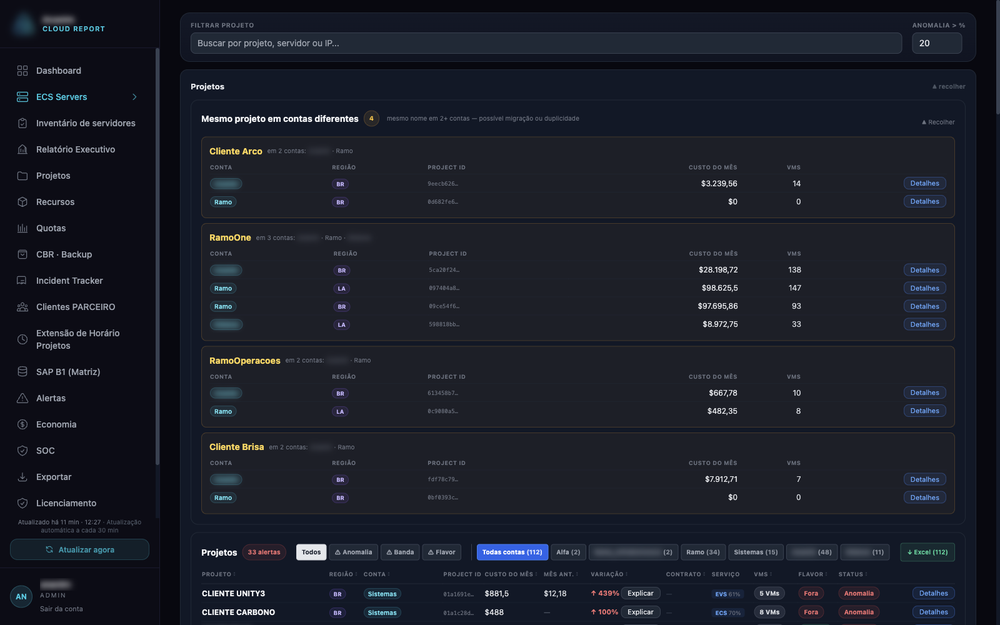 Projects & servers</td><td width="33%">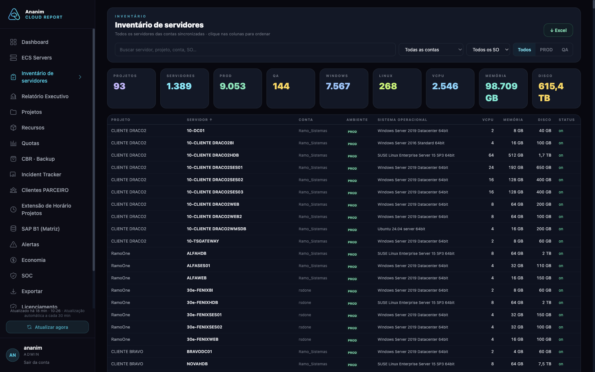 Server inventory</td></tr><tr><td width="33%">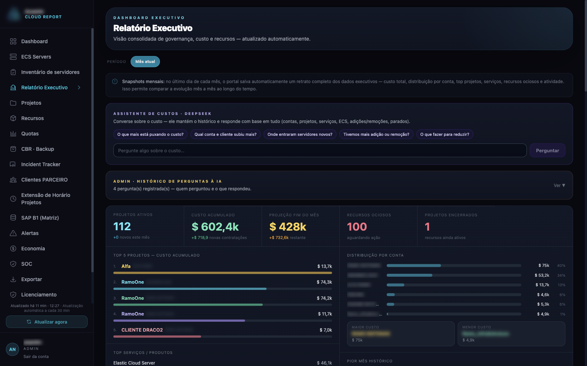 Executive report + AI cost assistant</td><td width="33%">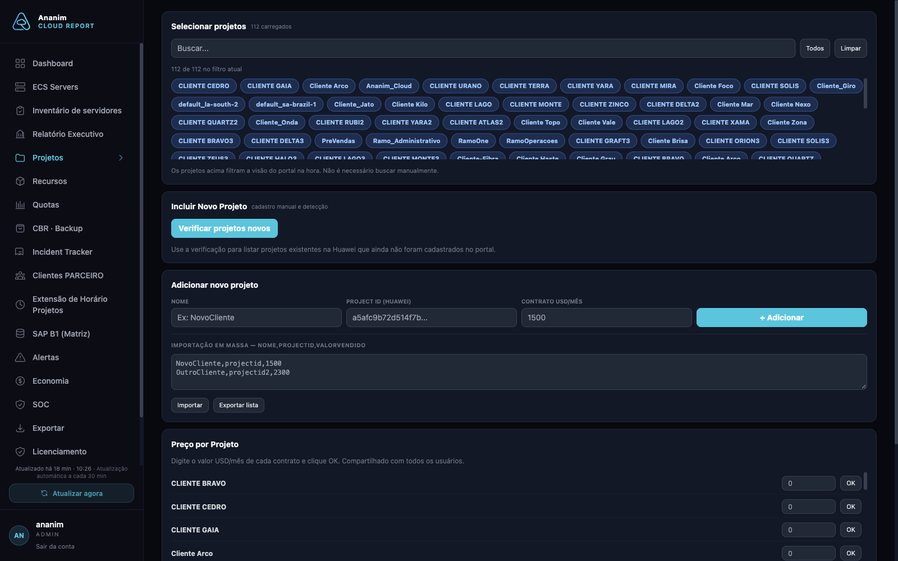 Project management & contract price</td><td width="33%">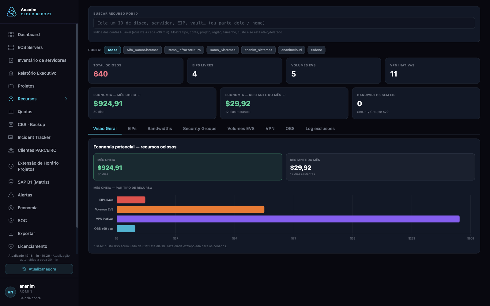 Resources & idle waste</td></tr></table>

## White-label and SaaS-ready

Cloud Report was built to be **white-label**. Brand name, logo, colors, report letterhead, tenant list, cloud accounts and integrations are configuration — not hard-coded. The same platform can be:

- **deployed for any company** — an MSP, a cloud reseller, a managed-services provider or an internal IT team;
- **run single-tenant** (one company, on its own infrastructure) or **multi-tenant**, with every tenant isolated by scope validated in the backend;
- **offered as a SaaS**, with per-tenant onboarding, role-based access and MFA already part of the design.

Accounts, projects, contract prices, policies (allowed flavors, bandwidth), thresholds and the report letterhead are all configurable — a reseller can run it for its own customers, and each customer can be given its own view.

Adapting it to a new company means configuring branding, connectors and credentials for that environment and validating them with its own data.

## Screen-by-screen tour

### 1. Executive cost dashboard

- Cost per cloud account with month-over-month variation, share of total and number of projects.
- Attributed vs unattributed cost, top services (compute, backup, block storage), daily run-rate and raw billing.
- Period selector (current month and previous months) and account filter; automatic refresh every 30 min.

### 2. Projects & servers

- Every project with region, account, monthly cost and VM count; cost-anomaly threshold filter.
- Detects **the same project in several accounts** (migration in progress or duplication).
- Alerts for anomaly, bandwidth and flavor out of policy; Excel export.

### 3. Server inventory

- All servers of all synced accounts: project, account, environment, operating system, vCPU, memory, disk and status.
- Totals for projects, servers, PROD/QA, Windows/Linux, vCPU, memory and disk; filters and Excel export.

### 4. Executive report + AI cost assistant

- **Automatic monthly snapshots**: on the last day of each month the portal stores a full picture (total cost, per account, top projects, services, idle resources) for month-over-month comparison.
- **AI cost assistant**: chat about cost — "what is driving cost?", "which account grew most?", "where did new servers appear?", "how to reduce?" — answering from all accounts, projects and services.
- Admin log of every question asked and the answer given.

### 5. Project management & contract price

- Select which projects are shown; filters apply instantly across the portal.
- "Check new projects" finds projects that exist in the cloud but are not registered yet.
- Contract value (USD/month) per project to compare **sold price vs real cost**; bulk CSV import/export.

### 6. Resources & idle waste

- Look up any resource ID across all accounts: type, account, project, region, size, cost, active or deleted.
- Idle resources: free public IPs, unattached volumes, inactive VPNs, bandwidth without IP, security groups, object storage.
- Potential savings for a full month and for the rest of the current month; exclusion log.

### 7. Quotas & capacity

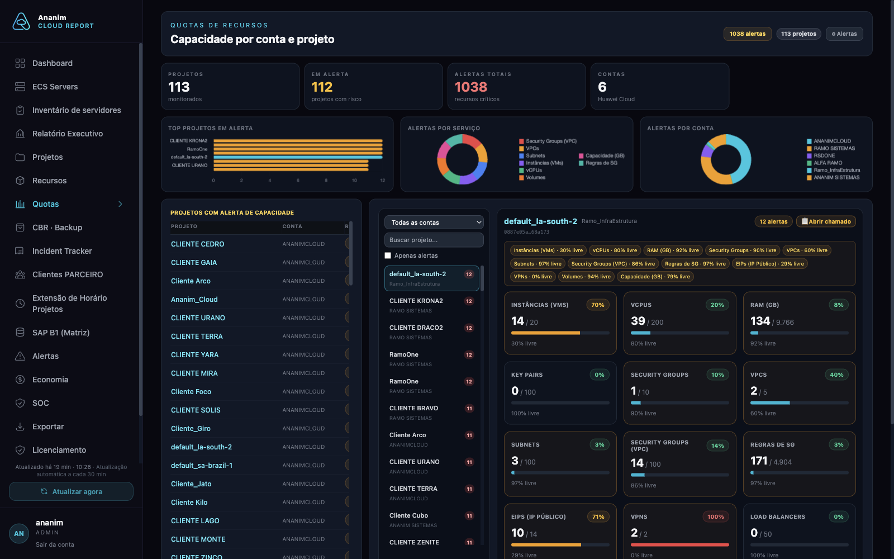

- Usage vs quota per account and project: VMs, vCPUs, RAM, VPCs, subnets, security groups and rules, public IPs, VPNs, volumes and capacity.
- Projects at risk, alerts by service and by account, configurable thresholds.

### 8. Backup (vaults) FinOps

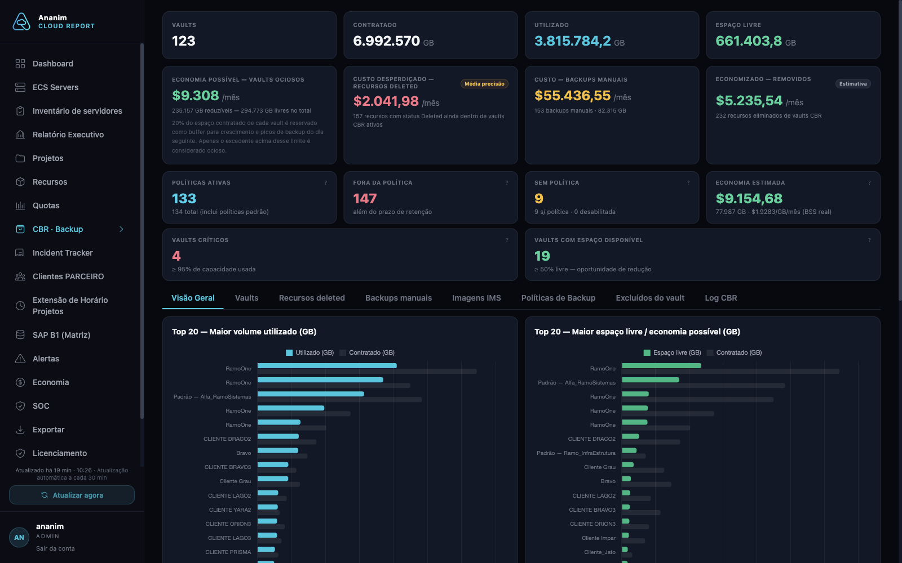

- Vaults contracted vs used vs free, with **reducible capacity** (keeping a 20 % growth buffer) and monthly savings.
- Cost wasted on deleted resources still inside active vaults; cost of manual backups; savings already achieved.
- Active backup policies and resources outside the retention policy.

### 9. Incident tracker

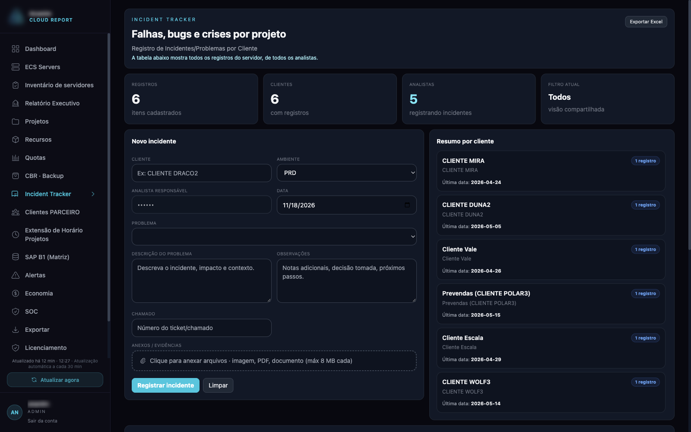

- Shared log of incidents/problems per client and environment, by analyst.
- Problem categories for ERP environments (service layer, add-ons, backups, memory, database full, etc.), ticket number and attachments.
- Summary per client; Excel export.

### 10. Partner clients & billing

- Monthly billing per managed client, users, VMs and VPN type.
- Top-10 charts (billing, users × VMs), XLSX import and client report.

### 11. Extended hours

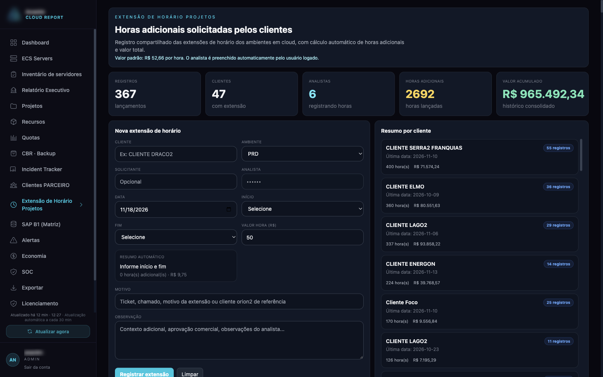

- Shared record of extra hours clients request to keep environments on, with automatic hour and value calculation.
- Analyst filled automatically from the logged-in user; totals and history.

### 12. ERP compatibility matrix

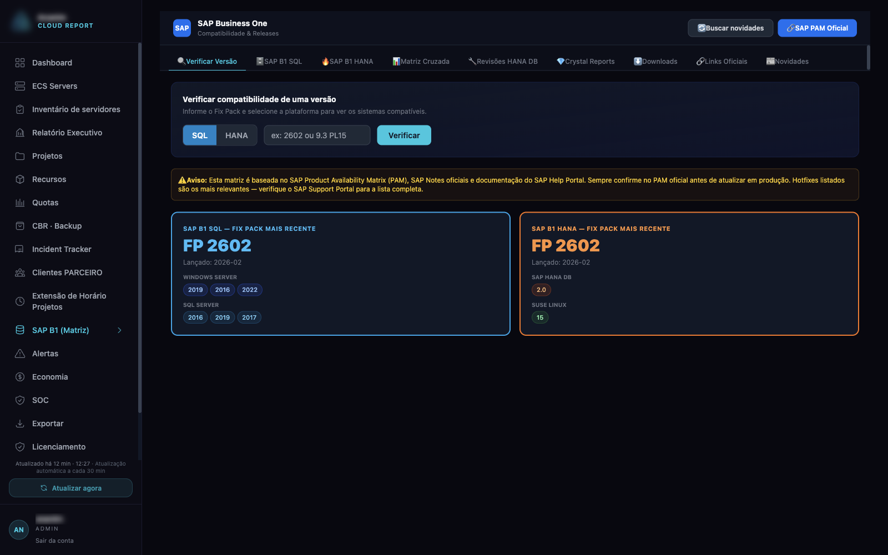

- Compatibility & releases for SAP Business One: latest Fix Pack and supported Windows / SQL Server / HANA / SUSE versions.
- Version check, cross matrix, database revisions, reporting tool versions, downloads, official links and news.

### 13. Governance alerts

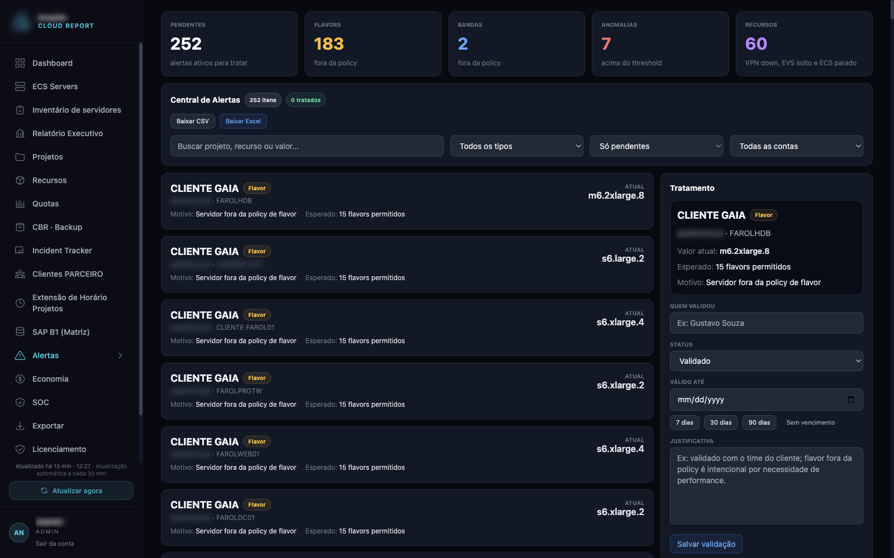

- Alert center: flavors out of policy, bandwidth out of policy, cost anomalies above threshold, VPN down, loose volumes, stopped servers.
- Pending vs treated workflow, filters by type and account, CSV / Excel export.

### 14. Savings

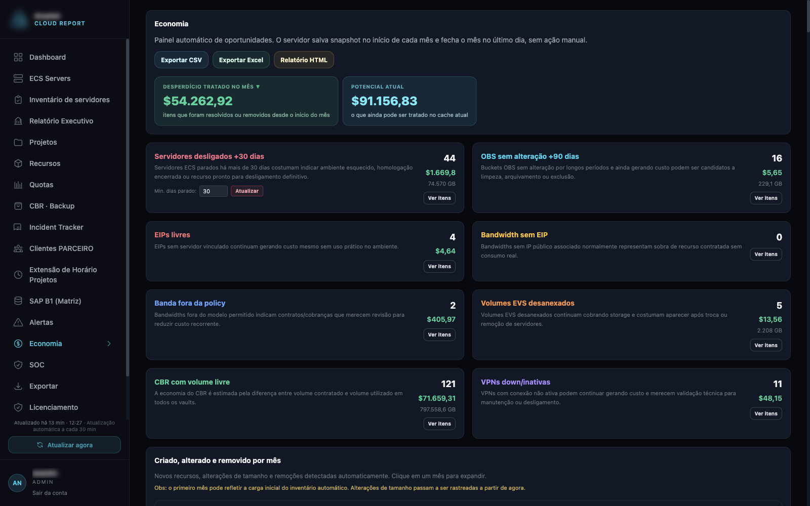

- Automatic savings opportunities: servers stopped for 30+ days, object storage unchanged for 90+ days, free public IPs, bandwidth without IP and more.
- Monthly open/close snapshot without manual action: waste treated this month vs current potential.
- Export CSV, Excel and HTML report.

### 15. SOC · host security

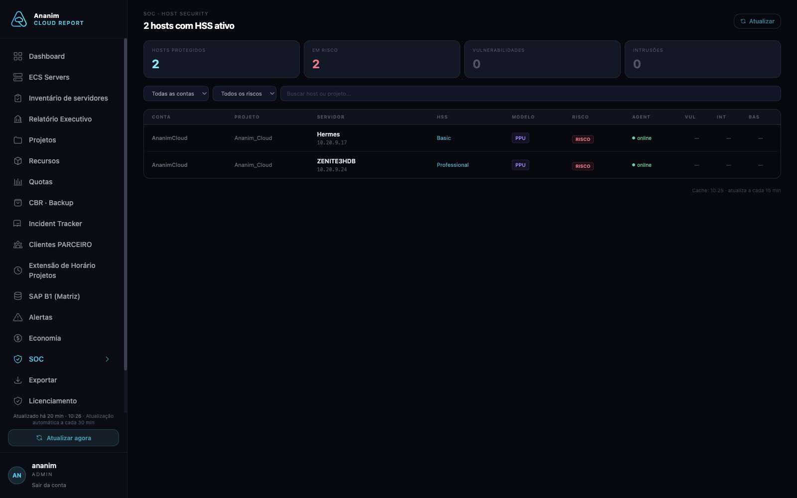

- Host security service status per server: protection edition, risk, agent, vulnerabilities, intrusions and baseline.

### 16. Report export

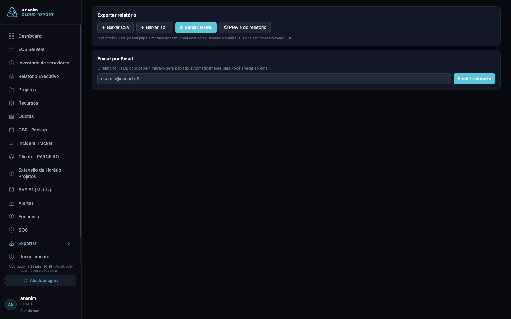

- CSV, TXT and branded HTML report with letterhead, tables and AI analysis — printable to PDF.
- Preview and send by e-mail.

### 17. Licensing & OS lifecycle

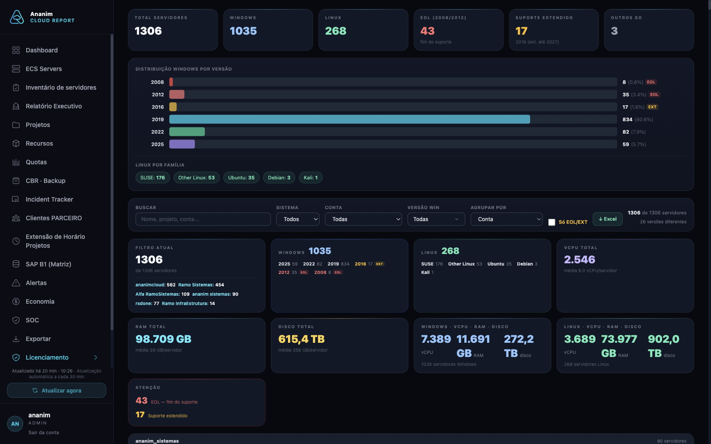

- Operating-system distribution across the fleet: Windows by version, Linux by family.
- End-of-life (2008/2012) and extended-support servers flagged; group by account, project or OS; Excel export.

### 18. Network topology

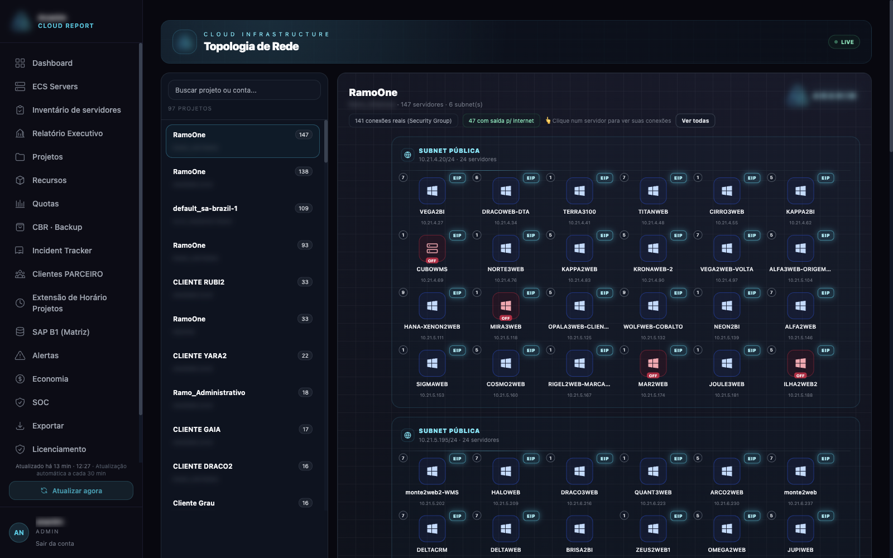

- Live topology per project: subnets, servers, public IPs, internet egress and real connections from security-group rules.

## FinOps: connecting consumption, cost and accountability

| FinOps practice | How the project supports it |
|---|---|
| Cost visibility | Consolidates spend and compares periods to explain how consumption evolves. |
| Allocation & accountability | Organizes by account and project, with contract price per project. |
| Variance investigation | Links invoice changes to inventory and operational context; anomaly alerts. |
| Usage optimization | Idle resources, stopped servers, vault sizing, quotas and schedules with estimated savings. |
| Financial governance | Monthly snapshots and shared reports between engineering and management. |
| Value communication | Shows cost next to criticality and purpose, avoiding decisions based only on price. |

## Cloud providers

The product is not tied to one brand: providers are plugged in through connectors for billing, inventory and operations. Each connector has to handle its own model of accounts, projects, regions, services, currency and billing. **Huawei Cloud** is the integration running in production today; adding another provider means implementing and validating its connector.

## How it works

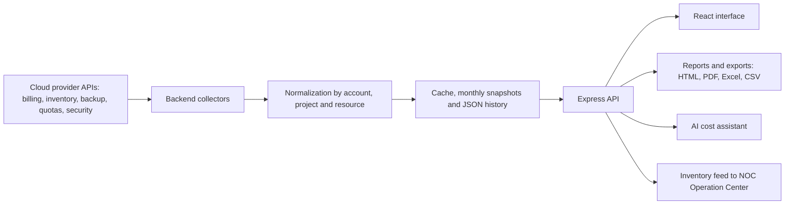

**Stack:** React · TypeScript · Vite · Tailwind CSS · Node.js · Express · cloud provider APIs · JSON persistence · LLM API for the assistant.

Architecture decisions and limits: [ARCHITECTURE.md](ARCHITECTURE.md) · Evolution ideas: [ROADMAP.md](ROADMAP.md) · Screenshot notes: [VISUALS.md](VISUALS.md)

## Example

A team sees a project's cost increase. It compares periods, checks servers and volumes, looks at backup vaults and schedules, opens the savings panel and asks the AI assistant what changed. The decision weighs cost, criticality and dependencies — the platform never shuts down resources just because they look expensive.

## Skills demonstrated

- Turning financial and operational questions into a product used by engineering and management.
- Integrating many cloud APIs while keeping each number's meaning explicit.
- Automating month-end snapshots, alerts and reports.
- Applying AI where it helps (cost Q&A) with auditability.
- Honest documentation of estimates vs realized savings.

## Important limits

- Provider coverage depends on the connector; Huawei Cloud is the integration in production.
- Estimates and opportunities are not realized or guaranteed savings.
- Inventory, billing and operational state may be refreshed at different times.
- Reports do not replace invoice validation, license contracts or restore tests.

## Source code

The source code is kept in a private repository. This repository is a portfolio: documentation and screenshots only — no operational code, credentials, access to environments or client data. Third-party trademarks and components remain subject to their own rights and licenses.

## Related projects

- [NOC Operation Center](https://github.com/gsouzacloud/noc-operation-center-portfolio) — operations, correlation, users & security
- [Cloud Report](https://github.com/gsouzacloud/cloud-report-portfolio) — cloud FinOps & governance
- [Shield](https://github.com/gsouzacloud/shield-portfolio) — WAF & application security

[Gustavo Souza on GitHub](https://github.com/gsouzacloud) · Documentation updated November 18, 2026.
