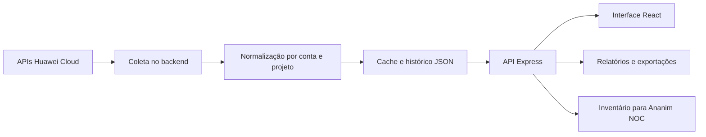

# AnanimCloudReport

**Cloud FinOps & Governance**  
Da fatura ao recurso. Do recurso à decisão.

Plataforma de custos e governança para ambientes Huawei Cloud. Reúne faturamento, inventário e contexto operacional para responder quanto cada projeto consome, quais recursos sustentam esse custo e onde há oportunidades de revisão.

> **Portfólio público de Gustavo Souza.** Este repositório apresenta o projeto; não contém o código operacional, acesso a ambientes ou dados de clientes. A imagem é uma composição demonstrativa baseada nas funcionalidades descritas, não uma captura da produção. Números e entidades são fictícios.

## O problema que o projeto resolve

A fatura isolada mostra valores, mas não explica o ambiente. Consultas distribuídas entre contas, projetos, máquinas, discos e backups tornam a análise manual lenta e sujeita a diferenças de critério. O projeto organiza essas informações em uma visão comum, com recorte por conta, projeto e período.

## O que faz hoje

A relação abaixo foi preparada a partir dos módulos e registros técnicos do projeto. Não representa uma nova auditoria de produção ou promessa de cobertura universal.

| Área | Capacidade implementada | Aplicação prática |
|---|---|---|
| Visão financeira | Consolidação de custos, comparação entre períodos e recorte por conta e projeto. | Acompanhar a evolução de um projeto e investigar variações antes de discutir otimização. |
| Inventário | Servidores, vCPU, memória, discos, sistema operacional e contexto do ambiente. | Relacionar o consumo financeiro aos recursos efetivamente cadastrados. |
| Backups e recursos | Visões de CBR, volumes, quotas e cobertura de recursos. | Apoiar revisão de capacidade e proteção sem considerar a existência de backup como prova de restauração. |
| Licenciamento e ciclo de vida | Inventário de sistemas operacionais e contexto de licenciamento/EOL. | Priorizar revisões técnicas e de ciclo de vida. |
| Operação e automação | Integrações com agendamentos de infraestrutura e painéis de governança. | Analisar janelas de funcionamento e apoiar operações controladas. |
| Relatórios e integração | Relatórios executivos, exportações e intercâmbio de inventário com o Ananim NOC. | Transformar dados técnicos em material utilizável por operação e gestão. |

## Como funciona

**Stack:** React · TypeScript · Vite · Tailwind CSS · Node.js · Express · APIs Huawei Cloud · JSON.

Veja as decisões e os limites da arquitetura em [ARCHITECTURE.md](ARCHITECTURE.md).

## Exemplo de uso

Uma equipe identifica aumento no custo de um projeto. Ela compara períodos, consulta máquinas e volumes, verifica o contexto de backups e agenda operacional e prepara uma revisão de capacidade. A decisão considera custo, criticidade e dependências; o painel não deve desligar recursos apenas por parecerem caros.

## Competências demonstradas

- Traduzir necessidades operacionais em uma aplicação utilizável.
- Integrar fontes de dados e preservar o significado de cada informação.
- Projetar controles de acesso, rastreabilidade e limites operacionais.
- Construir interfaces que apoiam diagnóstico e decisão.
- Documentar trade-offs, validação e caminhos de evolução.

## O que pode evoluir

As propostas de [ROADMAP.md](ROADMAP.md) estão separadas dos recursos existentes. Elas não são apresentadas como funcionalidades já entregues.

## Limites importantes

- O recorte implementado é Huawei Cloud; não é anunciado como plataforma multicloud pronta.
- Estimativas e oportunidades não equivalem a economia realizada ou garantida.
- Inventário, cobrança e estado operacional podem ter instantes de atualização diferentes.
- Relatórios não substituem validação da fatura, contrato de licenciamento ou teste de restauração.

## Sobre as imagens e o código

As telas deste repositório usam somente conteúdo fictício e ilustram a proposta funcional. A aparência da produção pode diferir. Não há dados operacionais embutidos, links de acesso aos ambientes ou demonstração conectada a sistemas reais.

O código-fonte é mantido em repositório privado. Não existe autorização de uso ou distribuição do sistema operacional por meio deste repositório. Marcas e componentes de terceiros permanecem sujeitos aos direitos e licenças correspondentes.

## English overview

A Huawei Cloud cost and governance platform that connects billing, infrastructure inventory, backups and operational context. The project demonstrates API integration, FinOps workflows and executive reporting. Additional cloud providers and advanced optimization workflows are evolution proposals, not delivered capabilities.

## Projetos relacionados

- [AnanimCloudReport](https://github.com/gsouzacloud/ananim-cloud-report-portfolio)
- [Ananim NOC](https://github.com/gsouzacloud/ananim-noc-portfolio)
- [Ananim Shield](https://github.com/gsouzacloud/ananim-application-shield-portfolio)

[Perfil de Gustavo Souza](https://github.com/gsouzacloud) · Documentação preparada em 18/11/2026.
