# AnanimCloudReport

**FinOps e Governança Cloud** — da fatura ao recurso, do recurso à decisão.

[English](README.md) · [Português](README.pt-BR.md)

Plataforma de FinOps, custos e governança para ambientes cloud. Junta faturamento, inventário, backups, quotas, licenciamento e contexto operacional para responder *quanto cada projeto consome, quais recursos sustentam esse custo, o que está ocioso e onde agir*.

> **Portfólio de Gustavo Souza.** **Sobre as imagens:** são capturas reais da interface em produção (novembro/2026). Nomes de clientes, hostnames, IPs, usuários, e-mails e domínios foram substituídos automaticamente no momento da captura por nomes fictícios (ex.: `CLIENTE ALFA`, `app2.exemplo.com`, `usuario.1`, `10.20.x.x`); valores financeiros estão embaralhados. Layout, funcionalidades e fluxos são exatamente os que rodam em produção.

## O problema

A fatura mostra valores, mas não explica o ambiente. Os dados ficam espalhados entre contas, projetos, servidores, discos, backups e quotas, e a análise manual fica lenta e inconsistente. O AnanimCloudReport coloca tudo em uma visão com filtros por conta, projeto e período, e transforma isso em alertas, economia e relatórios.

## Resumo

| Área | O que entrega |
|---|---|
| **Visibilidade de custo** | Custo por conta e projeto, mês a mês, atribuído × não atribuído, principais serviços. |
| **Inventário** | Todos os servidores com SO, vCPU, memória, disco, ambiente e status; licenciamento / fim de suporte. |
| **Desperdício e economia** | IPs, volumes, VPNs, buckets ociosos, servidores parados, vaults de backup superdimensionados — com valor por mês. |
| **Governança** | Política de flavor e banda, anomalia de custo, uso de quotas, projetos duplicados. |
| **Backups** | Capacidade de vaults, recursos deletados ainda cobrados, backups manuais, recursos fora da política. |
| **Negócio** | Preço de contrato × custo real, faturamento de parceiros, cobrança de extensão de horário, registro de incidentes. |
| **IA** | Assistente de custos que responde sobre todas as contas, com histórico de perguntas para o admin. |
| **Relatórios** | Snapshots mensais automáticos, HTML/PDF com papel timbrado, Excel e CSV em todo lugar, e-mail. |

<table><tr><td width="33%">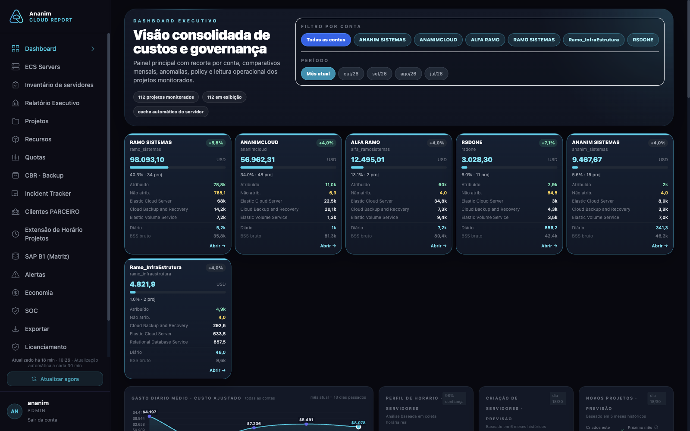 Dashboard executivo de custos</td><td width="33%">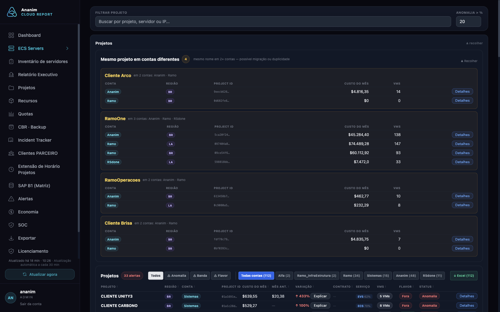 Projetos e servidores</td><td width="33%">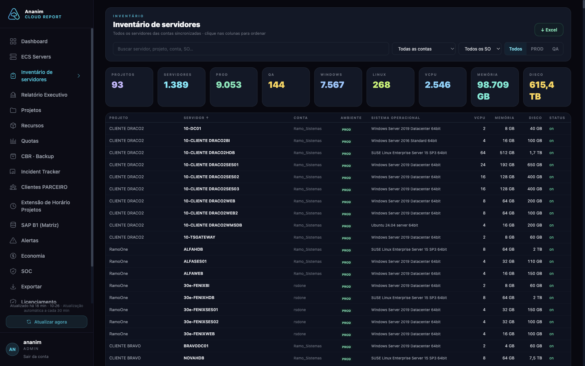 Inventário de servidores</td></tr><tr><td width="33%">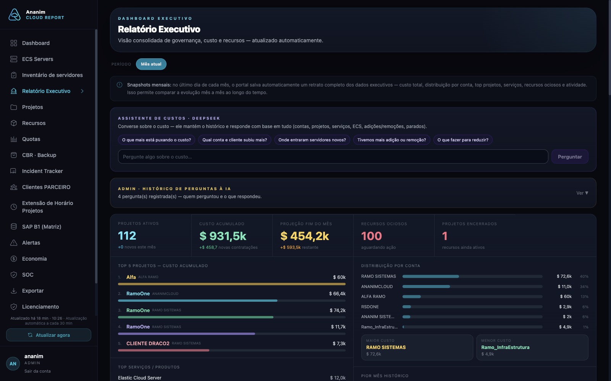 Relatório executivo + assistente de IA</td><td width="33%">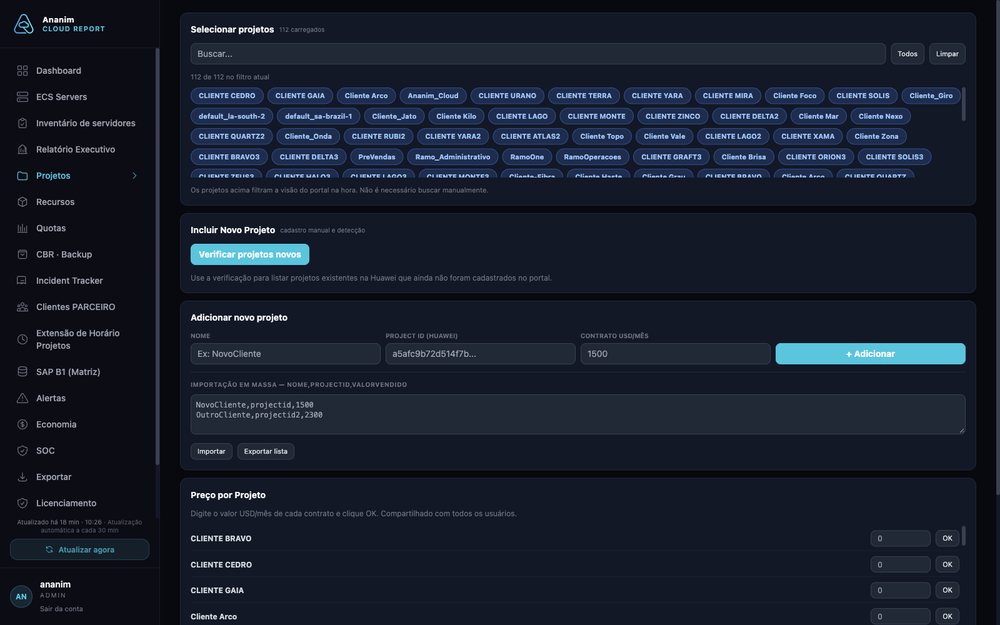 Gestão de projetos e preço de contrato</td><td width="33%">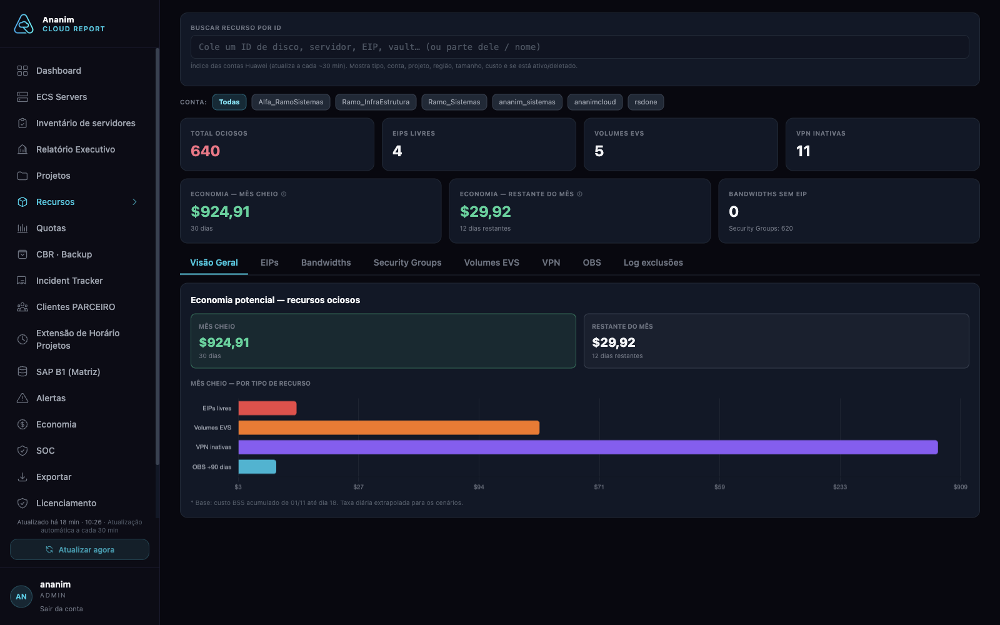 Recursos e desperdício ocioso</td></tr></table>

## White-label e pronto para SaaS

O AnanimCloudReport foi construído para ser **white-label**. Nome, logo, cores, papel timbrado dos relatórios, lista de clientes, contas cloud e integrações são configuração — não estão fixos no código. A mesma plataforma pode ser:

- **implantada para qualquer empresa** — MSP, revenda de cloud, provedor de serviços gerenciados ou time interno de TI;
- **operada como single-tenant** (uma empresa, na própria infraestrutura) ou **multi-tenant**, com cada cliente isolado por escopo validado no backend;
- **oferecida como SaaS**, com onboarding por cliente, perfis de acesso e MFA já previstos no desenho.

Contas, projetos, preço de contrato, políticas (flavors e banda permitidos), limiares e o papel timbrado dos relatórios são configuráveis — uma revenda pode operar para os próprios clientes, e cada cliente pode receber a sua visão.

Adaptar para uma nova empresa significa configurar marca, conectores e credenciais daquele ambiente e validar com os dados dela.

## Tour tela a tela

### 1. Dashboard executivo de custos

- Custo por conta cloud com variação mês a mês, participação no total e quantidade de projetos.
- Custo atribuído × não atribuído, principais serviços (computação, backup, disco), média diária e faturamento bruto.
- Seletor de período (mês atual e anteriores) e filtro por conta; atualização automática a cada 30 min.

### 2. Projetos e servidores

- Todos os projetos com região, conta, custo do mês e quantidade de VMs; filtro por limiar de anomalia de custo.
- Detecta **o mesmo projeto em várias contas** (migração em andamento ou duplicidade).
- Alertas de anomalia, banda e flavor fora da política; exportação Excel.

### 3. Inventário de servidores

- Todos os servidores de todas as contas sincronizadas: projeto, conta, ambiente, sistema operacional, vCPU, memória, disco e status.
- Totais de projetos, servidores, PROD/QA, Windows/Linux, vCPU, memória e disco; filtros e exportação Excel.

### 4. Relatório executivo + assistente de IA

- **Snapshots mensais automáticos**: no último dia de cada mês o portal salva um retrato completo (custo total, por conta, top projetos, serviços, recursos ociosos) para comparar mês a mês.
- **Assistente de custos com IA**: conversa sobre custo — "o que mais puxa o custo?", "qual conta subiu mais?", "onde entraram servidores novos?", "como reduzir?" — respondendo com base em todas as contas, projetos e serviços.
- Histórico (admin) de todas as perguntas feitas e respostas dadas.

### 5. Gestão de projetos e preço de contrato

- Seleciona quais projetos aparecem; o filtro vale na hora para todo o portal.
- "Verificar projetos novos" encontra projetos que existem na nuvem e ainda não foram cadastrados.
- Valor de contrato (USD/mês) por projeto para comparar **preço vendido × custo real**; importação/exportação em massa.

### 6. Recursos e desperdício ocioso

- Busca qualquer ID de recurso em todas as contas: tipo, conta, projeto, região, tamanho, custo, ativo ou deletado.
- Recursos ociosos: IPs públicos livres, volumes soltos, VPNs inativas, banda sem IP, security groups, object storage.
- Economia potencial para o mês cheio e para o restante do mês; log de exclusões.

### 7. Quotas e capacidade

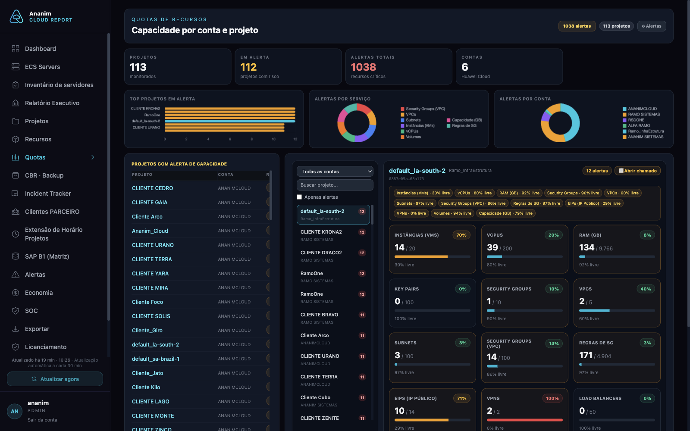

- Uso × quota por conta e projeto: VMs, vCPUs, RAM, VPCs, sub-redes, security groups e regras, IPs públicos, VPNs, volumes e capacidade.
- Projetos em risco, alertas por serviço e por conta, limiares configuráveis.

### 8. FinOps de backup (vaults)

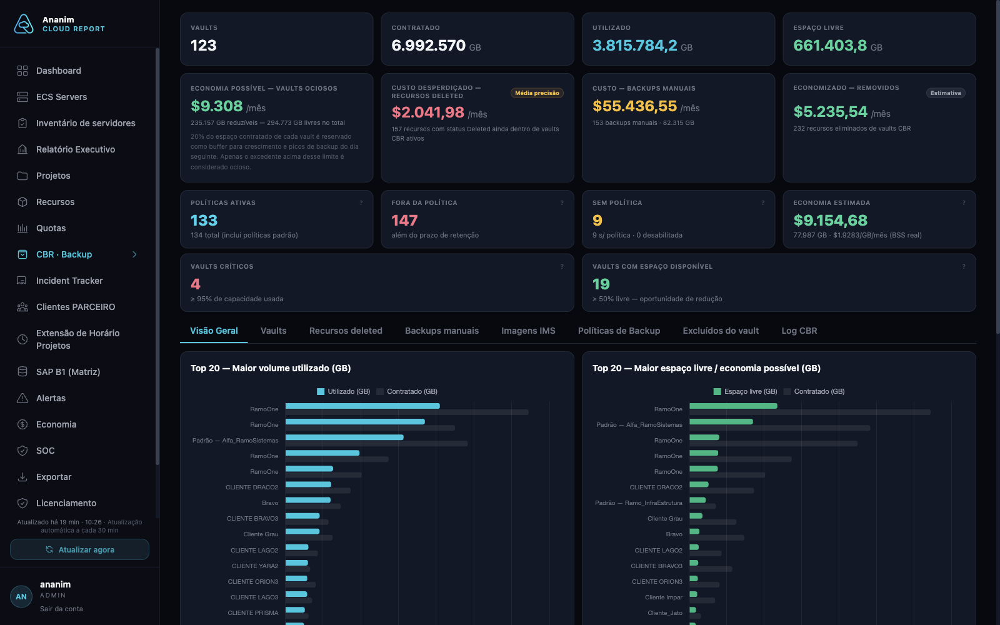

- Vaults contratado × utilizado × livre, com **capacidade reduzível** (mantendo 20 % de folga) e economia mensal.
- Custo desperdiçado com recursos deletados ainda dentro de vaults ativos; custo de backups manuais; economia já obtida.
- Políticas de backup ativas e recursos fora da política de retenção.

### 9. Registro de incidentes

- Registro compartilhado de incidentes/problemas por cliente e ambiente, por analista.
- Categorias para ambientes ERP (service layer, add-ons, backup, memória, banco cheio etc.), número de chamado e anexos.
- Resumo por cliente; exportação Excel.

### 10. Clientes parceiros e faturamento

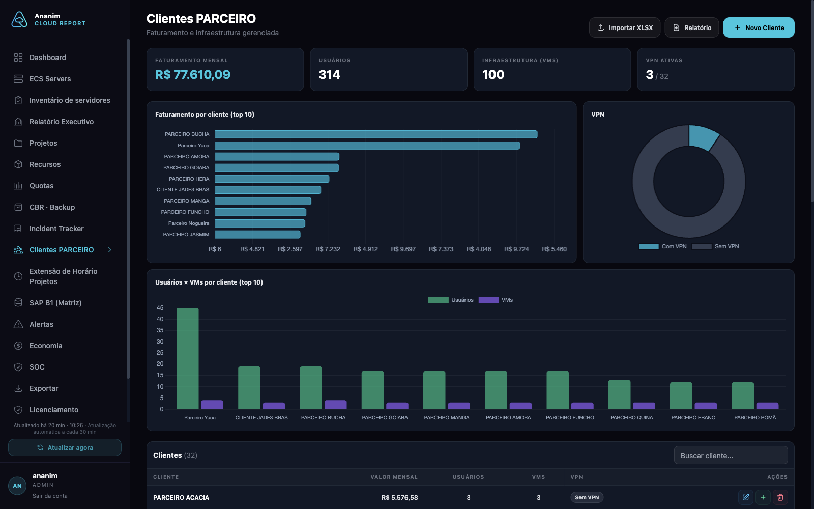

- Faturamento mensal por cliente gerenciado, usuários, VMs e tipo de VPN.
- Gráficos top-10 (faturamento, usuários × VMs), importação XLSX e relatório por cliente.

### 11. Extensão de horário

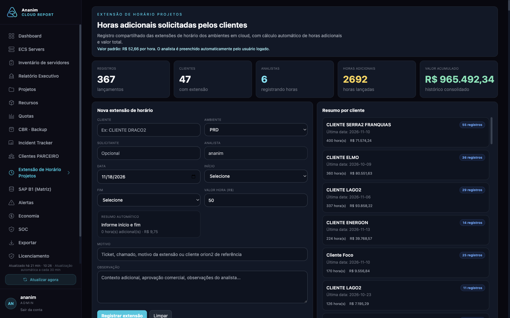

- Registro compartilhado das horas adicionais que os clientes pedem para manter ambientes ligados, com cálculo automático de horas e valor.
- Analista preenchido automaticamente pelo usuário logado; totais e histórico.

### 12. Matriz de compatibilidade ERP

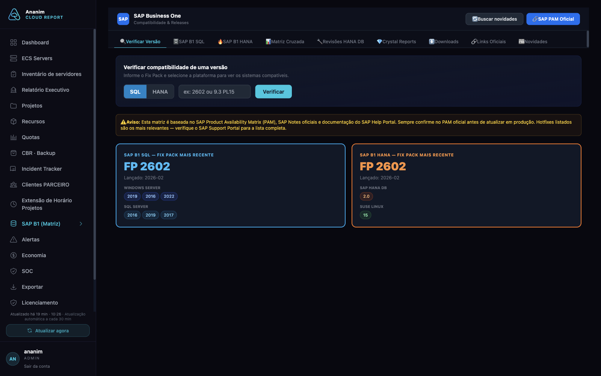

- Compatibilidade e releases do SAP Business One: Fix Pack mais recente e versões suportadas de Windows / SQL Server / HANA / SUSE.
- Verificação de versão, matriz cruzada, revisões do banco, versões da ferramenta de relatórios, downloads, links oficiais e novidades.

### 13. Alertas de governança

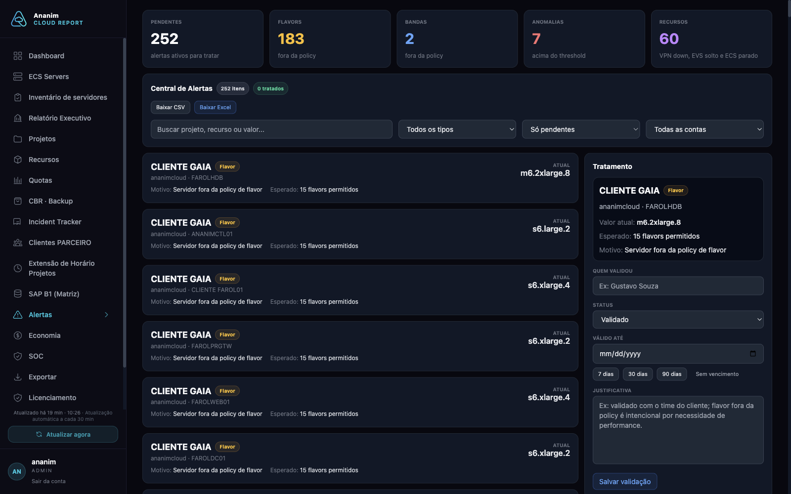

- Central de alertas: flavor fora da política, banda fora da política, anomalia de custo acima do limiar, VPN down, volume solto, servidor parado.
- Fluxo pendente × tratado, filtros por tipo e conta, exportação CSV / Excel.

### 14. Economia

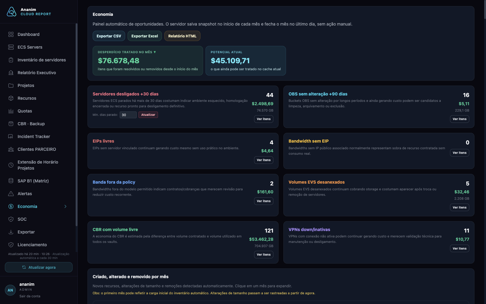

- Oportunidades automáticas: servidores parados há mais de 30 dias, object storage sem alteração há mais de 90 dias, IPs públicos livres, banda sem IP e outros.
- Snapshot de abertura/fechamento do mês sem ação manual: desperdício tratado no mês × potencial atual.
- Exportação CSV, Excel e relatório HTML.

### 15. SOC · segurança de hosts

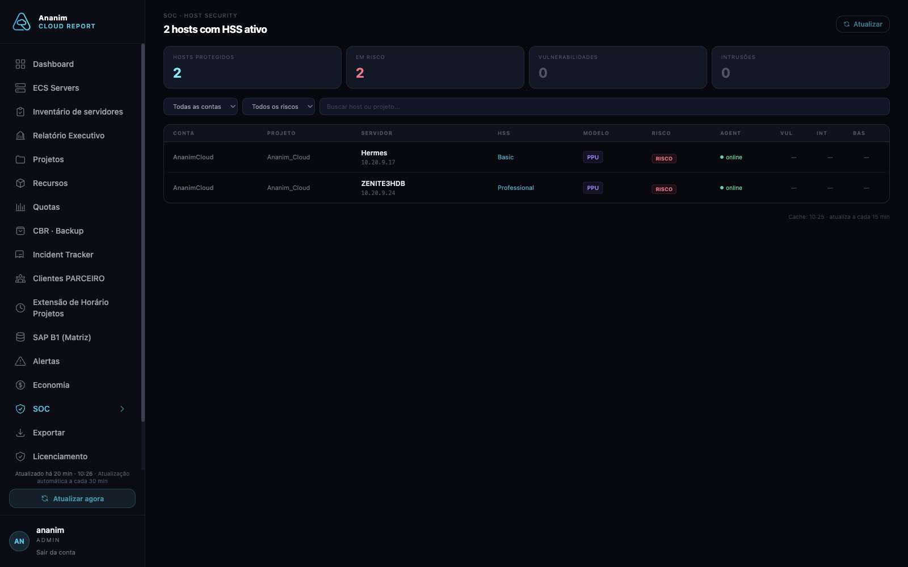

- Status do serviço de segurança de hosts por servidor: edição de proteção, risco, agente, vulnerabilidades, intrusões e baseline.

### 16. Exportação de relatório

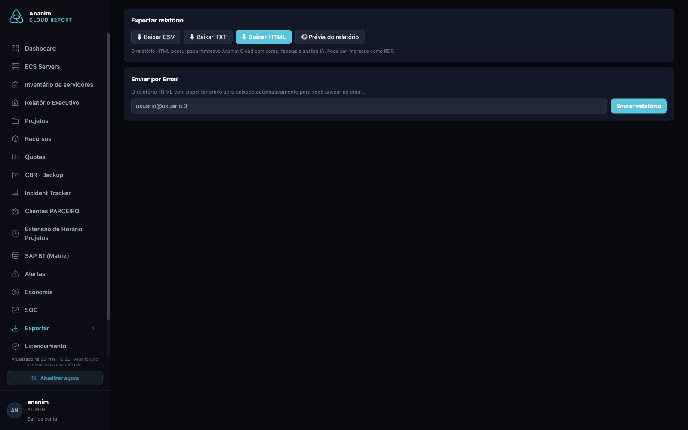

- Relatório CSV, TXT e HTML com papel timbrado, tabelas e análise de IA — imprimível em PDF.
- Prévia e envio por e-mail.

### 17. Licenciamento e ciclo de vida de SO

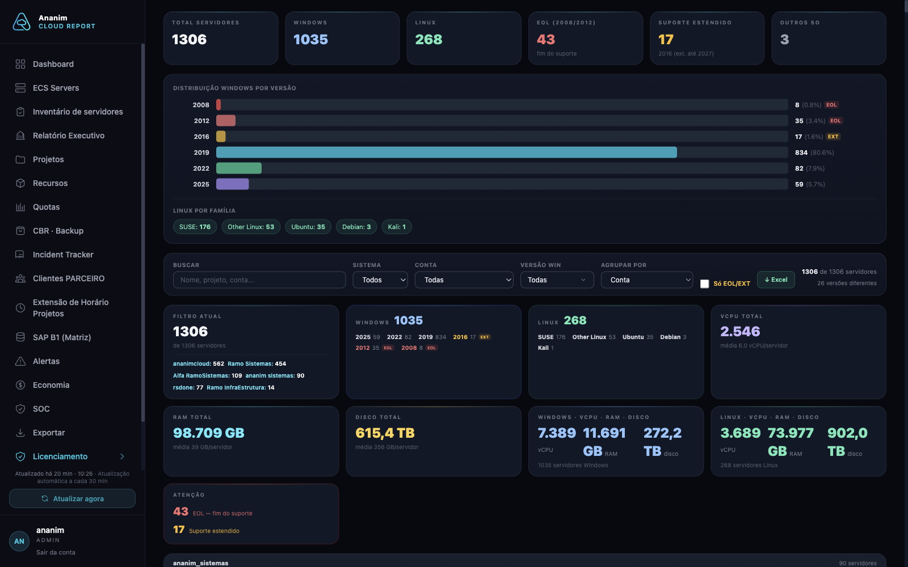

- Distribuição de sistemas operacionais na frota: Windows por versão, Linux por família.
- Servidores em fim de suporte (2008/2012) e suporte estendido destacados; agrupar por conta, projeto ou SO; exportação Excel.

### 18. Topologia de rede

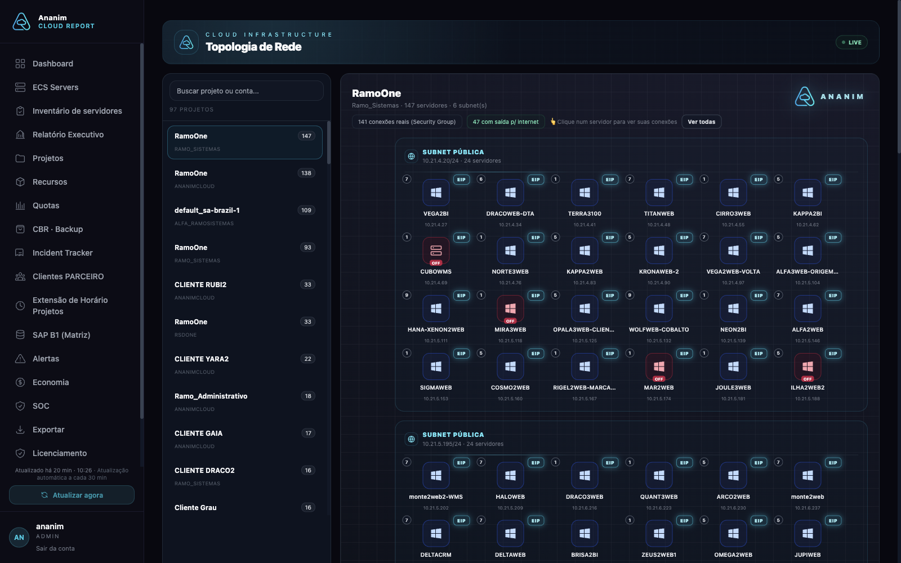

- Topologia ao vivo por projeto: sub-redes, servidores, IPs públicos, saída para internet e conexões reais pelas regras de security group.

## FinOps: conectar consumo, custo e responsabilidade

| Frente de FinOps | Como o projeto contribui |
|---|---|
| Visibilidade de custos | Consolida gastos e compara períodos para explicar a evolução do consumo. |
| Alocação e responsabilidade | Organiza por conta e projeto, com preço de contrato por projeto. |
| Investigação de variações | Liga mudanças na fatura ao inventário e ao contexto operacional; alertas de anomalia. |
| Otimização de uso | Recursos ociosos, servidores parados, dimensionamento de vaults, quotas e agendas com economia estimada. |
| Governança financeira | Snapshots mensais e relatórios compartilhados entre engenharia e gestão. |
| Comunicação de valor | Mostra o custo junto da criticidade e finalidade, evitando decidir só pelo preço. |

## Provedores de cloud

O produto não é preso a uma marca: os provedores entram por conectores de faturamento, inventário e operação. Cada conector trata o modelo de contas, projetos, regiões, serviços, moeda e cobrança daquele provedor. **Huawei Cloud** é a integração em produção hoje; incluir outro provedor exige implementar e validar o conector.

## Como funciona

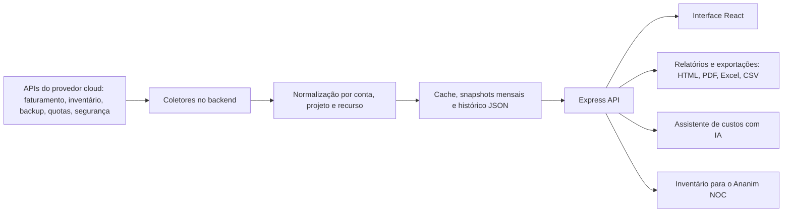

**Stack:** React · TypeScript · Vite · Tailwind CSS · Node.js · Express · APIs de provedores cloud · persistência JSON · API de LLM para o assistente.

Decisões e limites de arquitetura: [ARCHITECTURE.md](ARCHITECTURE.md) · Evolução: [ROADMAP.md](ROADMAP.md) · Sobre as imagens: [VISUALS.md](VISUALS.md)

## Exemplo de uso

A equipe vê o custo de um projeto subir. Compara períodos, consulta servidores e volumes, olha vaults de backup e agendas, abre o painel de economia e pergunta ao assistente de IA o que mudou. A decisão considera custo, criticidade e dependências — a plataforma nunca desliga recursos só porque parecem caros.

## Competências demonstradas

- Transformar perguntas financeiras e operacionais em um produto usado por engenharia e gestão.
- Integrar várias APIs cloud mantendo explícito o significado de cada número.
- Automatizar snapshots de fechamento de mês, alertas e relatórios.
- Aplicar IA onde ajuda (perguntas sobre custo) com rastreabilidade.
- Documentar com honestidade estimativa × economia realizada.

## Limites importantes

- A cobertura de provedores depende do conector; Huawei Cloud é a integração em produção.
- Estimativas e oportunidades não são economia realizada ou garantida.
- Inventário, cobrança e estado operacional podem ter momentos de atualização diferentes.
- Relatórios não substituem validação da fatura, contrato de licenciamento ou teste de restauração.

## Código-fonte

O código-fonte é mantido em repositório privado. Este repositório é um portfólio: apenas documentação e imagens — sem código operacional, credenciais, acesso a ambientes ou dados de clientes. Marcas e componentes de terceiros permanecem sujeitos aos respectivos direitos e licenças.

## Projetos relacionados

- [Ananim NOC](https://github.com/gsouzacloud/ananim-noc-portfolio) — operação, correlação, usuários e segurança
- [AnanimCloudReport](https://github.com/gsouzacloud/ananim-cloud-report-portfolio) — FinOps e governança cloud
- [Ananim Shield](https://github.com/gsouzacloud/ananim-application-shield-portfolio) — WAF e segurança de aplicações

[Gustavo Souza no GitHub](https://github.com/gsouzacloud) · Documentação atualizada em 18/11/2026.
